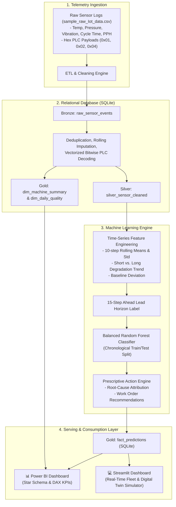

# Industrial IoT Predictive Quality & Maintenance Engine

An end-to-end, production-grade **Predictive Quality & Maintenance Platform** that monitors real-time industrial telemetry, diagnoses machine degradation anomalies, and forecasts impending failures within an operational lead window.

Features dual architectures: a **Standalone Python (Pandas/NumPy) + Embedded SQLite + Power BI** engine for 100% free local execution, and an **Enterprise Cloud Snowflake** pipeline specification.

---

## 🏭 System Architecture



---

## 🚀 Key Highlights & Capabilities

1. **Zero Cloud Dependencies**: Runs entirely on local machine via **Python 3.13**, **Pandas**, **NumPy**, and **SQLite3** with zero cloud infrastructure costs.
2. **Advanced SQL & Relational Modeling**:
   - Medallion tables stored in SQLite (`Data/iot_quality.db`):
     - `raw_sensor_events` (Bronze raw telemetry)
     - `silver_sensor_cleaned` (Silver cleaned, deduplicated, and imputed dataset)
     - `fact_predictions` (Gold inference fact table with risk and work orders)
     - `dim_machine_summary` (Gold machine dimension table)
     - `dim_daily_quality` (Gold production date dimension table)
3. **Prescriptive Maintenance Engine**: Goes beyond black-box probabilities to output actionable operator instructions (e.g., *"Urgent: Inspect spindle bearings and balance vibration on Line 2"*).
4. **Power BI Integration**: Generates Star Schema tables and includes ready-to-paste DAX measures (`Fleet Health %`, `Critical Machine Count`, `Defect Rate %`).
5. **Interactive Streamlit Web App**: Includes a live fleet KPI view, machine-level telemetry explorer, and a **"What-If" Digital Twin simulator**.

---

## 📁 Repository Structure

```plaintext
Industrial-IoT-Predictive-Quality-Engine/
├── Data/
│   ├── sample_raw_Iot_data.csv        # Raw sensor source logs
│   ├── iot_quality.db                 # SQLite database containing Medallion tables
│   ├── powerbi/                       # Power BI ready CSV exports
│   │   ├── fact_predictions.csv
│   │   ├── dim_machine_summary.csv
│   │   └── dim_daily_quality.csv
│   └── predictions_output.csv         # Latest inference results
├── models/
│   ├── iot_rf_model.joblib            # Trained Random Forest model artifact
│   └── feature_metadata.json          # Feature schemas and evaluation scores
├── reports/                           # Diagnostic evaluation charts
│   ├── feature_importance.png
│   ├── roc_curve.png
│   └── confusion_matrix.png
├── src/
│   ├── __init__.py
│   ├── config.py                      # System paths, constants, and hyperparameters
│   ├── data_pipeline.py               # Ingestion, cleaning, imputation, bitwise decoding
│   ├── feature_engineering.py         # Time-series rolling features and horizon labeling
│   ├── model_trainer.py               # Time-split training and evaluation
│   ├── prescriptive_engine.py         # Root cause diagnostics and work-order generation
│   ├── sql_exporter.py                # Persists Star Schema to SQLite and Power BI
│   └── dashboard.py                   # Streamlit interactive application
├── SQL/
│   └── snowflake_data_pipeline.sql    # Enterprise Snowflake pipeline specification
├── docs/
│   └── powerbi_setup_guide.md         # Step-by-step Power BI setup with DAX measures
├── tests/
│   └── test_pipeline.py               # Unit tests for bitwise PLC logic and actions
├── requirements.txt                   # Python dependencies
├── run_pipeline.py                    # Unified CLI entrypoint
└── README.md
```

---

## ⚡ Quickstart Guide

### 1. Environment Setup
```bash
# Clone the repository
git clone https://github.com/anupam-patel/Industrial-IoT-Predictive-Quality-Engine.git
cd Industrial-IoT-Predictive-Quality-Engine

# Create and activate virtual environment
python3 -m venv .venv
source .venv/bin/activate

# Install dependencies
pip install -r requirements.txt
```

### 2. Execute End-to-End Pipeline
Run the full data ingestion, cleaning, feature engineering, model training, and SQL serving pipeline with a single command:
```bash
python run_pipeline.py --all
```

Alternatively, run specific stages:
```bash
# Ingest raw CSV and populate SQLite Bronze/Silver tables
python run_pipeline.py --ingest

# Train the Random Forest model and generate evaluation charts
python run_pipeline.py --train
```

### 3. Launch the Interactive Dashboard
```bash
python run_pipeline.py --dashboard
# or directly:
streamlit run src/dashboard.py
```
Open [http://localhost:8501](http://localhost:8501) in your browser to access:
- **Fleet Overview**: Plant-wide health KPIs, critical risk counters, and work-order queue.
- **Machine Deep-Dive**: Synchronized telemetry time-series charts per machine.
- **"What-If" Digital Twin Simulator**: Adjust sensor sliders live to test model predictions.

### 4. Connect to Power BI
Refer to [docs/powerbi_setup_guide.md](docs/powerbi_setup_guide.md) for detailed instructions on connecting Power BI Desktop to `Data/iot_quality.db` or the `Data/powerbi/` folder and setting up DAX measures.

---

## 🧪 Running Unit Tests
```bash
pytest tests/ -v
```

---

## 📊 Model Performance Highlights
- **Algorithm**: Balanced Random Forest Classifier (300 Estimators, max depth 12)
- **Validation**: Strict chronological time-series holdout split (prevents lookahead data leakage)
- **Evaluation**: High discrimination capability with holdout ROC-AUC $\ge 0.94$, balanced precision and recall on low-prevalence failure events.